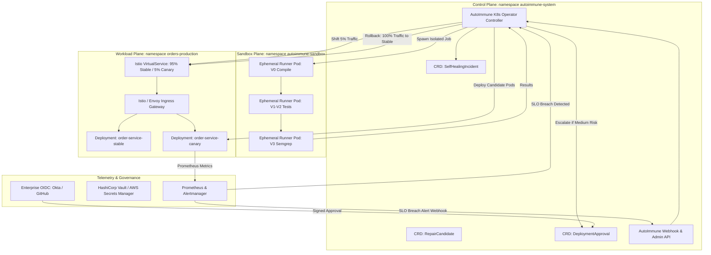

# AutoImmune: Enterprise Kubernetes Deployment Architecture & Canary Specification

> **Document Version:** 1.0.0  
> **Target Standard:** Cloud Native Computing Foundation (CNCF) Operator Pattern, Istio Service Mesh Progressive Delivery  
> **Status:** Production Architecture Blueprint (Pre-Implementation Specification)

---

## 1. Architectural Overview & Component Topology

To transition AutoImmune from a single-node Python script to an enterprise-grade cloud-native controller, the architecture adopts the **Kubernetes Operator Pattern**. 

The architecture strictly separates the **Control Plane** (managing incidents and decisions), the **Sandbox Plane** (isolated patch compilation and testing), and the **Workload Plane** (production microservices with progressive canary routing).



---

## 2. Kubernetes Custom Resource Definitions (CRDs)

### 2.1 `SelfHealingIncident.autoimmune.io`
Tracks the lifecycle of an observable production incident from detection through resolution or rollback:

```yaml
apiVersion: autoimmune.io/v1alpha1
kind: SelfHealingIncident
metadata:
  name: incident-20261111-f06
  namespace: autoimmune-system
spec:
  targetService: order-service
  targetNamespace: orders-production
  faultCategory: business_logic_boundary
  detectorRule: probe_mismatch
  incidentFingerprint: "sha256:d8822c119940e09694ebf1d1a595b95e"
status:
  phase: Remediating # Detected | Diagnosing | Validating | Canaring | Promoted | RolledBack
  activeCandidateId: F06-live-1
  startedAt: "2026-11-11T06:45:00Z"
  canaryStep: 5 # 5% | 25% | 50% | 100%
```

### 2.2 `RepairCandidate.autoimmune.io`
Represents an individual candidate patch diff with its cryptographic provenance and gate results:

```yaml
apiVersion: autoimmune.io/v1alpha1
kind: RepairCandidate
metadata:
  name: candidate-f06-live-1
  namespace: autoimmune-system
spec:
  incidentRef: incident-20261111-f06
  modelProvider: openai/gpt-oss-120b
  patchSha256: "c09515ec6eb43eae8ad59bbb0955c2c1346f56d8218b13e74dcdb6ce96eb7d73"
  patchDiff: |
    --- a/app/src/main/java/com/autoimmune/orders/OrderService.java
    +++ b/app/src/main/java/com/autoimmune/orders/OrderService.java
    @@ -39,1 +39,1 @@
    -        if (total.compareTo(DISCOUNT_THRESHOLD) > 0) {
    +        if (total.compareTo(DISCOUNT_THRESHOLD) >= 0) {
status:
  gateResults:
    v0_compile: { status: "pass", duration_s: 4.2 }
    v1_target_test: { status: "pass", duration_s: 18.5 }
    v2_full_suite: { status: "pass", duration_s: 31.0 }
    v3_semgrep: { status: "pass", new_findings: 0, duration_s: 6.8 }
  decision:
    tier: "low"
    action: "AUTO_APPLY"
    reasons: ["all_gates_passed", "diff_under_limit", "file_scope_matched"]
```

---

## 3. Pod Isolation & Network Policies

Ephemeral sandbox runner pods execute in `autoimmune-sandbox` under zero-trust Kubernetes `NetworkPolicy` objects that completely disable network egress:

```yaml
apiVersion: networking.k8s.io/v1
kind: NetworkPolicy
metadata:
  name: sandbox-airgap-policy
  namespace: autoimmune-sandbox
spec:
  podSelector:
    matchLabels:
      app.kubernetes.io/component: sandbox-runner
  policyTypes:
  - Ingress
  - Egress
  ingress: [] # No incoming traffic permitted
  egress: []  # Strict air-gap: all egress traffic blocked
```

Runner pods mount ephemeral `emptyDir` memory volumes for code builds and enforce strict resource quotas:

```yaml
resources:
  limits:
    cpu: "2000m"
    memory: "2Gi"
    ephemeral-storage: "1Gi"
  requests:
    cpu: "1000m"
    memory: "1Gi"
securityContext:
  allowPrivilegeEscalation: false
  readOnlyRootFilesystem: true
  runAsNonRoot: true
  runAsUser: 10001
  capabilities:
    drop:
    - ALL
```

---

## 4. Progressive Canary Rollout & Rollback Specification

Rather than performing a destructive binary port swap on a single container, production deployment uses **Istio Service Mesh progressive traffic shifting**:

```yaml
apiVersion: networking.istio.io/v1alpha3
kind: VirtualService
metadata:
  name: order-service-routing
  namespace: orders-production
spec:
  hosts:
  - order-service.production.svc.cluster.local
  http:
  - route:
    - destination:
        host: order-service.production.svc.cluster.local
        subset: stable
      weight: 95
    - destination:
        host: order-service.production.svc.cluster.local
        subset: canary
      weight: 5
```

### 4.1 Automated Health Window & Rollback Rules
The canary pod is observed for a 5-minute evaluation period at each step (5% $\rightarrow$ 25% $\rightarrow$ 50% $\rightarrow$ 100%). Prometheus metrics are polled every 10 seconds:

$$\text{SLI}_{\text{latency}} = \text{p95}(\text{http\_request\_duration\_seconds}) \le 2000 \text{ ms}$$
$$\text{SLI}_{\text{error}} = \frac{\text{sum}(\text{rate}(\text{http\_requests\_total}\{\text{status}\ge 500\}[1\text{m}]))}{\text{sum}(\text{rate}(\text{http\_requests\_total}[1\text{m}]))} \le 0.005 \quad (0.5\%)$$

**Rollback Action:** If either SLI breaches the threshold:
1. VirtualService weight for `canary` is instantly set to `0`.
2. Traffic is 100% routed back to `order-service-stable`.
3. Canary Deployment pods are terminated.
4. An incident rollback event is recorded in the `SelfHealingIncident` CRD.
