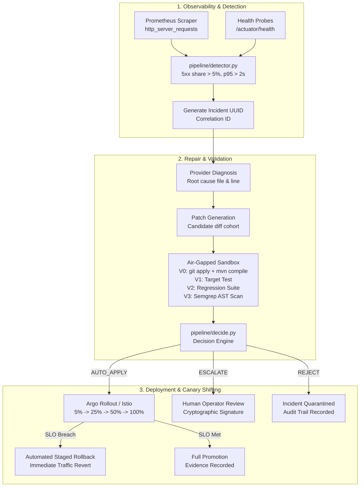

# AutoImmune: Production Operations & Incident Response Runbook

## 1. System Operational Architecture

AutoImmune operates as a dual-plane autonomous self-healing control loop for Java microservices:



---

## 2. Standard Operating Procedures (SOP)

### SOP-01: Incident Detection & Alert Triage
- **Trigger:** AlertManager fires `AutoImmuneIncidentDetected` when error rate exceeds 5% or p95 latency exceeds 2,000ms over a 15-second evaluation window.
- **Action:**
  1. Inspect incident ID in structured logs: `grep "incident_id=<UUID>" /var/log/autoimmune/orchestrator.log`.
  2. Confirm target microservice and health state: `kubectl get pods -l app=order-service -n autoimmune-system`.
  3. Verify detector status: `python -m pipeline.observe status`.

### SOP-02: Handling Human Escalation (`ESCALATE`)
- **Trigger:** The decision engine flags a candidate with decision tier `medium` (`ESCALATE`).
- **Reasons for Escalation:**
  - Diff modifies a file on the sensitive path allowlist (e.g. `application.properties`, security packages).
  - Diff size exceeds `max_diff_lines` (default: 20 lines).
  - Diff touches files outside the single diagnosed root-cause file.
  - Multi-sample diagnosis shows disagreement across candidate root causes.
  - V3 Semgrep scan detects a low/medium severity finding.
- **Action:**
  1. Retrieve patch artifact from run directory: `cat runs/<run_id>/<candidate_id>/candidate.diff`.
  2. Inspect decision reasons: `cat runs/<run_id>/<candidate_id>/decision.json`.
  3. Verify cryptographic hash of the patch: `sha256sum runs/<run_id>/<candidate_id>/candidate.diff`.
  4. Issue signed decision: `python -m pipeline approve --run-id <run_id> --candidate-id <candidate_id> --decision APPROVE --reviewer <operator_id>`.

### SOP-03: Automated Progressive Canary Verification
- **Rollout Stages:**
  - Stage 1: **5% traffic** for 180 seconds.
  - Stage 2: **25% traffic** for 300 seconds.
  - Stage 3: **50% traffic** for 300 seconds.
  - Stage 4: **100% full promotion**.
- **Canary Promotion Criteria:**
  - `http_server_requests` 5xx error rate $\le 0.1\%$.
  - p95 latency $\le 50$ms.
  - `/actuator/health` probe returns HTTP 200 with `status: UP`.
- **Automated Rollback Criteria:**
  - Two consecutive probe failures or error rate $> 0.1\%$ triggers an immediate, zero-downtime traffic swap back to the stable baseline image.

### SOP-04: Disaster Recovery & Emergency Manual Override
- **Procedure to abort an active repair loop:**
  ```bash
  kubectl patch rollout order-service-rollout -n autoimmune-system --type merge -p '{"spec":{"paused":true}}'
  kubectl rollout undo rollout/order-service-rollout -n autoimmune-system
  ```
- **Freeze Automated Patching:**
  ```bash
  touch /etc/autoimmune/DISABLE_AUTO_APPLY
  ```
