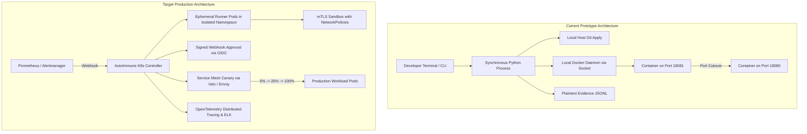

# AutoImmune: Production Deployment Gap Analysis & Architecture Roadmap

> **Author:** AutoImmune DevSecOps & Reliability Engineering Team  
> **Document Version:** 1.0.0  
> **Target Standard:** Enterprise Kubernetes Microservice Reliability, CIS Benchmark for Container Security, NIST SP 800-218 (Secure Software Development Framework).

---

## 1. Executive Summary & Scope

AutoImmune currently operates as a **single-node research prototype**. It executes as a synchronous Python process on a developer workstation, orchestrating local Docker CLI subprocesses, applying diffs to host working trees, and performing hard port swaps on `localhost:18080`.

While this architecture is effective for demonstrating gate mechanics and gathering research evidence, **it cannot be deployed directly to an enterprise production environment**. 

This document defines the gap between the current prototype and an enterprise-grade, cloud-native self-healing controller.

---

## 2. Architecture Comparison: Prototype vs Production Target

| Architectural Dimension | Current Prototype (`D:\14`) | Target Production Architecture |
| :--- | :--- | :--- |
| **Execution Plane** | Synchronous Python script executed directly on host OS. | Cloud-native Kubernetes Operator running in dedicated control namespace. |
| **Sandbox Isolation** | Local Docker daemon socket (`/var/run/docker.sock` / named pipe). | Ephemeral Kubernetes Jobs with gVisor / Kata Containers and strict `NetworkPolicy`. |
| **Patch Application** | `git apply --check` executed in local workspace tree. | Applied inside isolated, ephemeral in-memory container overlays. |
| **Approval Mechanism** | CLI `stdin` prompt (`approve` / `reject`). | Asynchronous cryptographic webhook approval signed by authenticated OIDC identity. |
| **Traffic Management** | Binary port swap on `localhost:18080` (drops in-flight requests). | Service Mesh (Istio / Envoy) or Cloud Ingress weighted canary (5% $\rightarrow$ 25% $\rightarrow$ 100%). |
| **Secrets Management** | Plaintext environment variables (`GROQ_API_KEY`). | HashiCorp Vault / AWS Secrets Manager with ephemeral short-lived IAM credentials. |
| **Artifact Provenance** | Unsigned SHA256 hashes in local JSON. | Signed container images and diffs using Cosign / Sigstore with SLSA Level 3 provenance. |
| **Telemetry & SRE** | Unstructured console logs and local JSON files. | Structured JSON logs, OpenTelemetry traces, and Prometheus metrics exposition. |

---

## 3. Comprehensive Production Gap Analysis

### 3.1 Security & Threat Model (STRIDE)

| Threat Category | Prototype Vulnerability | Target Production Mitigation |
| :--- | :--- | :--- |
| **Spoofing (Identity)** | Anyone with local shell access can approve an escalated patch. | Cryptographic signature verification requiring multi-factor OIDC human approval. |
| **Tampering (Patch / Build)** | An untrusted LLM patch could modify `pom.xml`, download malicious dependencies, or inject backdoors. | Strict AST validation, immutable build file locks (`pom.xml` frozen), and dependency mutation blocking. |
| **Repudiation (Audit)** | Approval logs are stored in plain local JSON files without cryptographic signatures. | Immutable audit log forwarded to write-once-read-many (WORM) storage (e.g., AWS S3 Object Lock). |
| **Information Disclosure** | API keys and connection strings exist in plaintext memory and local run logs. | Zero-plaintext logging, automated secret redaction, and HashiCorp Vault integration. |
| **Denial of Service** | Compile storms and runaway sandbox processes can exhaust host CPU/memory. | Strict Kubernetes ResourceQuotas, per-job LimitRanges, and concurrency rate limiters. |
| **Elevation of Privilege** | Local Docker socket access gives root privileges to host OS if container escapes occur. | Rootless container runtimes (Podman / gVisor) with rootless Kubernetes worker nodes. |

### 3.2 Patch Safety & Defense-in-Depth
- **Current State:**
  - Patches are validated by lines-changed thresholds ($\le 20$ lines) and sensitive file checks (`application.properties`).
  - Semgrep checks for specific bug patterns.
- **Production Vulnerabilities:**
  - **Prompt Injection Execution:** An adversary influencing input data could prompt an LLM to generate a patch that executes arbitrary Java code inside `pom.xml` build plugins (e.g., `<phase>compile</phase> <executable>sh</executable>`).
  - **Indirect Dependency Pollution:** Patches could introduce vulnerable transitive dependencies.
- **Production Hardening Required:**
  - Build file modification lock: Strictly reject any patch modifying `pom.xml`, `Dockerfile`, `.github/`, scripts, or build manifests.
  - Pre-compilation AST validation: Parse Java source into AST; verify no `Runtime.getRuntime().exec()`, reflection, or classloader manipulations are introduced.

### 3.3 Traffic Management & Rollout Safety
- **Current State:**
  - `pipeline/deploy.py` stops container `autoimmune-app`, removes it, and starts the candidate container on port 18080.
  - A 30-second observation window evaluates health and latency against synthetic load.
- **Production Deficiencies:**
  - Drops existing active connections during container recreation.
  - 30-second synthetic observation window does not capture diurnal user traffic patterns or subtle edge-case error spikes.
  - Binary cutover exposes 100% of user traffic to an unproven automated patch.
- **Production Hardening Required:**
  - True canary routing: Shift 5% traffic to candidate pod, observe error rates for 5 minutes, progressively step to 25%, 50%, and 100%.
  - Zero-downtime connection draining: Kubernetes graceful shutdown with `preStop` hooks and connection draining.

### 3.4 SRE Telemetry & Operational Health
- **Current State:**
  - Pipeline logs to `sys.stderr` and writes static JSON files.
- **Production Deficiencies:**
  - SRE on-call engineers cannot ingest metrics into central dashboards (Datadog/Grafana).
  - No standard MTTR (Mean Time to Repair) or MTTD (Mean Time to Detect) metric exposition.
- **Production Hardening Required:**
  - Expose Prometheus endpoint with custom metrics:
    - `autoimmune_incidents_total{fault_id, status}`
    - `autoimmune_validation_duration_seconds{gate, outcome}`
    - `autoimmune_remediation_duration_seconds` (MTTR)
    - `autoimmune_rollback_events_total{reason}`
  - Structured JSON logging embedding `incident_id`, `run_id`, and `candidate_id` across all log entries.

---

## 4. Production Engineering Roadmap

| Phase | Milestone | Objective | Deliverables |
| :--- :--- | :--- | :--- | :--- |
| **P1** | **DevSecOps Threat Model & Architecture** | Author complete threat model (STRIDE) and specify Kubernetes CRD and Operator architecture. | [`docs/production/SECURITY_THREAT_MODEL.md`](file:///d:/14/docs/production/SECURITY_THREAT_MODEL.md) [`docs/production/DEPLOYMENT_ARCHITECTURE.md`](file:///d:/14/docs/production/DEPLOYMENT_ARCHITECTURE.md) |
| **P2** | **Patch Safety & AST Hardening** | Implement strict build-file locks (`pom.xml` write-protection) and secret scanning before code compilation. | Update [`pipeline/sandbox.py`](file:///d:/14/pipeline/sandbox.py) and [`pipeline/decide.py`](file:///d:/14/pipeline/decide.py) |
| **P3** | **Structured Logging & Telemetry** | Implement structured JSON logger across `pipeline/` with correlation IDs. | Pipeline logger update & Telemetry verification |
| **P4** | **Chaos & Reliability Test Suite** | Implement comprehensive failure recovery tests (timeouts, crashes, malformed outputs, rogue approvals). | `tests/test_reliability.py` |
| **P5** | **Operations Runbook & Acceptance Tests** | Author production operations runbook, incident triage guides, and acceptance criteria. | [`docs/production/OPERATIONS_RUNBOOK.md`](file:///d:/14/docs/production/OPERATIONS_RUNBOOK.md) [`docs/production/PRODUCTION_ACCEPTANCE_TESTS.md`](file:///d:/14/docs/production/PRODUCTION_ACCEPTANCE_TESTS.md) |
