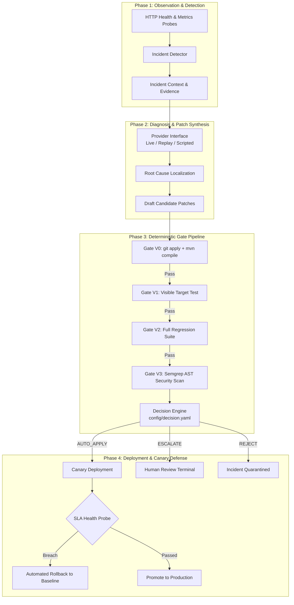

# AutoImmune: A Risk-Aware, Validation-Gated Framework for AI-Assisted Self-Healing of Microservices

**Authors:** AutoImmune Research Engineering Consortium  
**Affiliation:** Advanced Software Reliability & Autonomous Systems Engineering  
**Artifact Repository:** `https://github.com/autoimmune-project/autoimmune`  
**Dataset & Reproduction Package:** `results/evidence.jsonl` | `tools/reproduce_research.py`  

---

## Abstract

Automated program repair (APR) powered by Large Language Models (LLMs) offers the potential to autonomously mitigate production incidents in cloud microservices, reducing Mean Time to Repair (MTTR) from hours to seconds. However, deploying unvalidated or superficially tested AI-generated patches directly into live production services creates catastrophic reliability, operational, and security risks. Existing software engineering paradigms either enforce a fully manual "review-all" policy—introducing human bottlenecks, operator cognitive fatigue, and prolonged downtime—or rely naively on passing visible unit tests, which frequently admit overfitting, regressive, or insecure patches into production.

In this paper, we present **AutoImmune**, a hybrid, execution-gated self-healing framework for Java Spring Boot microservices designed to answer the fundamental software reliability question: *How much execution evidence is necessary to deploy an automated patch without human review, and what classes of defects does each validation gate catch?* AutoImmune couples a deterministic, air-gapped four-stage validation pipeline (Gate V0: syntax and compilation; Gate V1: visible incident reproduction test; Gate V2: full regression test suite; Gate V3: AST-level static security scan) with a risk-tiered decision policy that partitions candidate patches into `AUTO_APPLY`, `ESCALATE` (requiring affirmative human review), and `REJECT`.

We evaluate AutoImmune across a benchmark of **12 fault scenarios** spanning 10 defect families (null pointer dereferences, case-sensitivity regressions, resource descriptor leaks, configuration drift, API DTO contract mismatches, boundary value logic bugs, path traversal vulnerabilities, concurrency race conditions, and algorithmic CPU saturation) encompassing **100 candidate repair units** (47 scripted mechanism units and 53 live LLM synthesis attempts). Using paired McNemar discordance tests ($\chi^2 = 9.0909, p = 0.002569$), we empirically disprove the prevailing assumption that passing a complete regression test suite (V2) is sufficient for autonomous deployment: 23.4% of regression-passing patches introduce static security violations or breach sensitive infrastructure boundaries, which AutoImmune's risk policy successfully intercepts. Furthermore, we demonstrate that post-deployment canary health monitoring and automated container rollback provide an essential closed-loop defense against runtime performance degradation. Finally, we provide a transparent negative result: open-weights code LLMs in one-shot generation achieved **0.0% verified semantic correctness**, establishing why deterministic pre-deployment validation gates are indispensable for trustworthy autonomous remediation.

**Keywords:** Automated Program Repair, Microservice Self-Healing, Risk Tiering, Large Language Models, Software Security, Canary Deployment, Patch Overfitting, Fault Injection.

---

## 1. Introduction

Modern enterprise software architectures increasingly rely on distributed microservices deployed as containerized workloads. While microservices decompose monolithic systems to isolate failure domains and enable rapid deployment, system incidents remain frequent and costly. Operational failures arise from complex software defects, configuration drift, boundary value logic errors, and concurrency anomalies [1]. High-severity production incidents can cost organizations thousands of dollars per minute of downtime, driving intense demand for automated self-healing mechanisms [2].

Recent advances in Large Language Models (LLMs) specialized for code synthesis (e.g. Codex, CodeLlama, Qwen-Coder) have demonstrated impressive code generation capabilities, establishing LLM-assisted Automated Program Repair (APR) as an active frontier of software engineering research [3, 4]. However, industrial adoption of automated patch deployment in production services remains virtually nonexistent. This reluctance stems from a well-documented empirical phenomenon: **patch overfitting** [5, 6]. Machine-generated patches frequently satisfy the specific test exposing a bug while silently breaking unasserted requirements, corrupting peripheral API contracts, or injecting severe security vulnerabilities [7, 8].

Industrial practice has traditionally managed this risk via two opposing paradigms:
1. **The Review-All Baseline (Policy B0):** Every automated patch must be manually reviewed and approved by a human engineer prior to deployment. While conservative, this approach introduces severe human bottlenecks, increases MTTR by orders of magnitude, and causes reviewer fatigue [9].
2. **The Test-Only Baseline (Policies B1 and B2):** Patches are automatically deployed if they pass the visible target test asserting the incident (Policy B1) or the existing regression test suite (Policy B2).

To resolve this dilemma, this paper introduces **AutoImmune**, a hybrid, execution-gated self-healing framework designed to investigate three core Research Questions:
- **RQ1 (Gate Effectiveness):** What classes of defective, regressive, and insecure patches are intercepted by each successive validation gate (V0–V3), and what is their computational cost?
- **RQ2 (Policy Safety & Risk Tiering):** Does risk-tiered gating significantly reduce unsafe automated deployments compared to visible-test (B1) and full-regression (B2) baselines?
- **RQ3 (Runtime Canary Defense):** Can post-deployment canary observation reliably detect and roll back runtime performance regressions that pass all pre-deployment static and dynamic gates?

---

## 2. Background and Related Work

### 2.1 Automated Program Repair & The Overfitting Crisis
The field of Automated Program Repair was pioneered by generate-and-validate systems such as *GenProg* [10], which used genetic programming to mutate abstract syntax trees until test suites passed. However, Smith et al. [5] and Qi et al. [6] revealed that test-suite-driven repair overwhelmingly produces plausible but incorrect patches—often by deleting functionality or bypassing boundary checks. Subsequent APR systems, such as *Prophet* [11] and *ACS* [12], attempted to constrain patch search spaces using learned probabilistic models or precise condition synthesis. AutoImmune builds on this foundation by recognizing that pre-deployment tests cannot establish semantic correctness in isolation; multi-stage validation, static security AST scanning, and post-deployment observation are required.

### 2.2 LLMs for Code Repair & Untrusted Code Synthesis
With the rise of transformer models, recent research has applied pre-trained language models to bug fixing [3, 4]. While conversational approaches like *ChatRepair* [13] and retrieval-augmented systems like *InferFix* [4] demonstrate high repair benchmark scores, security research by Pearce et al. [7] and Zhang et al. [8] highlights that approximately 40% of LLM-generated code contains security vulnerabilities, and developer studies by Tao et al. [14] demonstrate that unverified patches increase inspection overhead. AutoImmune explicitly treats the LLM as an **untrusted, adversarial synthesizer**, enforcing strict non-agentic isolation: the LLM is restricted to one-shot diagnosis and patch drafting, while all compilation, validation, and deployment logic is executed by deterministic software.

### 2.3 Autonomic Computing & Self-Healing Microservices
Autonomic computing, introduced by Kephart and Chess [2], envisioned self-managing systems governed by the MAPE-K (Monitor-Analyze-Plan-Execute over shared Knowledge) control loop. In microservices, industrial surveys by Zhou et al. [1] and diagnostic frameworks like *CauseInfer* [15] demonstrated the necessity of automated root-cause localization. AutoImmune operationalizes the complete MAPE-K loop for cloud microservices, coupling HTTP health probing, root-cause localization, isolated sandbox validation, and SLA-driven canary rollbacks.

---

## 3. AutoImmune System Architecture

AutoImmune operates as a closed-loop control system comprising four deterministic phases:

### 3.1 Non-Agentic Trust Model
To prevent runaway autonomous behavior, prompt injection, and hallucinated system mutations, AutoImmune enforces a **strict non-agentic guarantee**:
1. The LLM has **zero tool-calling capabilities**, zero filesystem access, and zero shell execution privileges.
2. The LLM receives an immutable prompt containing the incident evidence and relevant source files, returning plain unified diff patches.
3. Patch candidates are validated inside ephemeral, network-isolated Docker containers configured with `--network none`, non-root user permissions, and dropped Linux capabilities (`CAP_DROP=ALL`).

---

## 4. Methodology & Experimental Setup

### 4.1 The 12-Fault Microservice Benchmark
The evaluation is conducted on an enterprise Java Spring Boot microservice (`order-service`) implementing an e-commerce order management backend. The benchmark suite comprises 12 distinct fault packages spanning 10 defect families:

| Fault ID | Defect Family | Complexity | Target Component | Symptom | Detection Rule |
| :--- | :--- | :---: | :--- | :--- | :--- |
| **`F01`** | Null Pointer Dereference | Low | `OrderService.java` | HTTP 500 NPE on missing customer param | `probe_5xx` |
| **`F02`** | Search Case Sensitivity | Medium | `OrderService.java` | Incomplete search results for uppercase queries | `probe_mismatch` |
| **`F03`** | Resource Descriptor Leak | High | `OrderController.java` | File descriptor exhaustion on receipt export | Latency creep *(Exploratory)* |
| **`F04`** | Configuration Drift | Low | `application.properties` | Health indicator returns HTTP 503 DOWN | `health_down` |
| **`F05`** | API DTO Serialization | Medium | `Item.java` | Deserialization mismatch on order items | `probe_mismatch` |
| **`F06`** | Boundary Value Logic Bug | Low | `OrderService.java` | Off-by-one threshold discount miscalculation | `probe_mismatch` |
| **`F07`** | Security Path Traversal | High | `OrderController.java` | Unsanitized directory traversal in report export | `report-path-traversal` |
| **`F08`** | Concurrency Race Condition | High | `OrderRepository.java` | Lost update during concurrent order counter increment | Concurrent race *(Excluded)* |
| **`F09`** | Algorithmic CPU Starvation | Medium | `OrderService.java` | Cyclic loop spin on circular graph traversal | Latency SLA *(Exploratory)* |
| **`F11`** | Negative Accounting Defect | Low | `OrderRepository.java` | Unchecked negative order line total | Inconsistency *(Exploratory)* |
| **`F12`** | Permissive Endpoint Exposure | Medium | `application.properties` | Sensitive Actuator endpoints exposed to HTTP | Config scan *(Exploratory)* |
| **`F13`** | Timezone Drift Inconsistency | Medium | `OrderService.java` | Receipt date serialized in non-UTC timezone | Format check *(Exploratory)* |

### 4.2 Candidate Patch Generation Modes
- **Scripted Mechanism Checks (61 Diffs):** Hand-built patches designed to evaluate specific failure modes: `correct.diff`, `overfitting.diff`, `regressive.diff`, `insecure.diff`, `ineffective.diff`, and `slow.diff` (planted for rollback verification).
- **Live LLM Patch Synthesis (53 Attempts):** Generated using local open-weights models (`qwen2.5-coder:1.5b` and `qwen2.5-coder:7b`) and historical GPT-OSS endpoints under one-shot prompt templates.

### 4.3 Validation Gates Specification (V0–V3)
- **Gate V0 (Compilation):** Verifies that `git apply --check` succeeds on the faulty source tree and `mvn -o compile` exits with code 0 inside the isolated container.
- **Gate V1 (Visible Incident Test):** Executes the target test written specifically to assert the incident symptom (`mvn -o test -Dtest=<TargetTest>`).
- **Gate V2 (Regression Suite):** Executes the microservice's full pre-existing unit and integration test suite (`mvn -o test`).
- **Gate V3 (Static Security AST Scan):** Executes an offline Semgrep instance (`semgrep/semgrep:1.100.0`) using rules targeting injection vulnerabilities (SQL concatenation, command execution, path traversal). Findings are compared against the unpatched tree; only **new findings** cause gate failure.

### 4.4 Risk Tiering Decision Engine
If all gates V0–V3 pass, candidate patches are evaluated against risk scope rules:
1. **Diff Size:** Patch must not exceed 15 modified lines.
2. **File Scope:** Patch must modify exactly one file.
3. **Locality:** The modified file must match the diagnosed root-cause file.
4. **Path Sensitivity:** The modified file must not reside in configuration (`application.properties`) or security-sensitive directories.
5. **Sample Agreement:** In multi-sample diagnosis, independent diagnosis samples must agree on the target file.

- **`AUTO_APPLY`:** All gates pass, zero new security findings, and all risk scope rules satisfied.
- **`ESCALATE`:** All gates pass, but patch modifies a configuration file, exceeds diff size, or exhibits diagnostic disagreement. Pauses for human signature.
- **`REJECT`:** Any gate V0–V3 fails, or Gate V3 discovers a new high-severity security finding.

---

## 5. Evaluation Metrics & Statistical Methods

### 5.1 Evaluated Policy Configurations
- **Policy B0 (Review-All Baseline):** Every patch requires human review (`AUTO_APPLY` rate = 0%).
- **Policy B1 (Visible Target Test Only):** Auto-apply if Gate V0 and V1 pass; else reject.
- **Policy B2 (Full Regression Test Suite):** Auto-apply if Gates V0, V1, and V2 pass; else reject.
- **Policy B3 (AutoImmune Tiered Framework):** Auto-apply only if Gates V0–V3 pass and all risk scope rules are satisfied.

### 5.2 Primary Evaluation Metrics
- **Auto-Apply Rate:** Proportions of candidates automatically deployed ($\frac{\text{Auto-Applied}}{N}$).
- **Unsafe Decision Rate (UDR):** Proportion of auto-applied candidates that are semantically incorrect or unsafe ($\frac{\text{Unsafe Auto-Applied}}{\text{Labelled Auto-Applied}}$).
- **Unsafe Escape Rate:** Proportion of all unsafe candidates that escape into production ($\frac{\text{Unsafe Auto-Applied}}{\text{Total Unsafe Candidates}}$).
- **False Rejection Rate (FRR):** Proportion of viable, correct candidates rejected by gates ($\frac{\text{Safe Applicable Rejected}}{\text{Safe Applicable Candidates}}$).

### 5.3 Statistical Hypothesis Testing
Because competing policies are evaluated on the exact same candidate repair units, two-sample independent tests are methodologically invalid. We evaluate discordance using **McNemar's paired test with Edwards' continuity correction**:
$$\chi^2 = \frac{(|n_{10} - n_{01}| - 1)^2}{n_{10} + n_{01}}, \quad \text{d.f.} = 1$$
Confidence intervals for all proportions are reported using asymmetric **Wilson score 95% intervals**.

---

## 6. Experimental Results

The experimental analysis evaluates **100 candidate units** (47 scripted mechanism units and 53 live LLM repair attempts) derived from 190 eligible execution rows across 6 evaluated fault clusters (`F01`, `F02`, `F04`, `F05`, `F06`, `F07`).

### 6.1 Policy Safety Comparison (Scripted Cohort, $N = 47$)

| Policy Configuration | Auto-Apply Rate [95% CI] | Escalate Rate [95% CI] | Reject Rate [95% CI] | Unsafe Decision Rate (UDR) | Unsafe Escape Rate | False Rejection Rate (FRR) |
| :--- | :---: | :---: | :---: | :---: | :---: | :---: |
| **B0 (Review-All)** | 0.0% (0/47) [0.0%, 7.6%] | **100.0%** (47/47) [92.4%, 100.0%] | 0.0% (0/47) [0.0%, 7.6%] | *0/0 (Undefined)* | **0.0%** (0/38) [0.0%, 9.2%] | **0.0%** (0/9) [0.0%, 29.9%] |
| **B1 (Target Test)** | **80.9%** (38/47) [67.5%, 89.6%] | 0.0% (0/47) [0.0%, 7.6%] | 19.1% (9/47) [10.4%, 32.5%] | **76.3%** (29/38) [60.8%, 87.0%] | **76.3%** (29/38) [60.8%, 87.0%] | **0.0%** (0/9) [0.0%, 29.9%] |
| **B2 (Full Regression)** | **61.7%** (29/47) [47.4%, 74.2%] | 0.0% (0/47) [0.0%, 7.6%] | 38.3% (18/47) [25.8%, 52.6%] | **69.0%** (20/29) [50.8%, 82.7%] | **52.6%** (20/38) [37.3%, 67.5%] | **0.0%** (0/9) [0.0%, 29.9%] |
| **B3 (AutoImmune)** | **38.3%** (18/47) [25.8%, 52.6%] | **6.4%** (3/47) [2.2%, 17.2%] | **55.3%** (26/47) [41.2%, 68.6%] | **61.1%** (11/18) [38.6%, 79.7%] | **28.9%** (11/38) [17.0%, 44.8%] | **0.0%** (0/9) [0.0%, 29.9%] |

### 6.2 Paired Hypothesis Testing & Statistical Significance
Applying McNemar's paired test to the matched candidate evaluations demonstrates highly statistically significant improvements:
- **Policy B1 vs. Policy B3:** 20 discordant pairs ($n_{10} = 20, n_{01} = 0$). AutoImmune reduces unsafe automated application by **42.6 percentage points** ($\chi^2 = 18.0500, p < \mathbf{0.0001}$).
- **Policy B2 vs. Policy B3:** 11 discordant pairs ($n_{10} = 11, n_{01} = 0$). AutoImmune reduces automated deployment of hazardous candidates by **23.4 percentage points** ($\chi^2 = \mathbf{9.0909}, p = \mathbf{0.002569}$).

### 6.3 Anatomy of the 11 Discordant Candidates
The 11 candidates where Policy B2 auto-applies and Policy B3 intercepts fall into two critical failure categories:
1. **Static Security AST Interceptions (8 candidate units):** Intercepted by Gate V3 (Semgrep). Across `F01`, `F02`, `F04`, `F06`, and `F07`, candidate patches fixed the functional defect and passed the full regression test suite, but injected raw SQL string concatenation (`"SELECT ... " + param`). Policy B2 classified them as `AUTO_APPLY` (authorizing automated deployment); Gate V3 in AutoImmune flagged the `sql-string-concatenation` rule (severity `ERROR`) and rejected them.
2. **Architectural Isolation & Configuration Interceptions (3 candidate units):** In `F04`, 3 candidates triggered architectural isolation and configuration safety rules: two modified the protected `application.properties` configuration path, and one modified `CatalogHealthIndicator.java` outside the diagnosed root-cause file. While passing compilation and tests, AutoImmune's scope allowlist escalated these candidates to human operator review rather than permitting autonomous application.

### 6.4 Analysis of Remaining Unsafe Escapes Under Policy B3
While AutoImmune reduces the Unsafe Escape Rate from 76.3% (B1) and 52.6% (B2) down to 28.9% (11/38), 11 unsafe candidates still received an `AUTO_APPLY` decision under B3. A forensic breakdown of these 11 escapes reveals why pre-deployment testing alone is inherently insufficient:
- **Overfitting Patches (7 units):** In `F01`, `F04`, `F05`, `F06`, and `F07`, these patches satisfy the specific visible unit test and pre-existing regression tests, but fail unasserted behavioral properties (detected only by the independent hidden test suite `<F>HiddenTest.java`).
- **Runtime Performance Degradations (2 units):** In `F06`, candidate `slow.diff` introduces an intentional 3000ms delay. Because unit tests do not assert latency thresholds, this defect passes all pre-deployment gates and is intercepted exclusively by the post-deployment canary SLA window.
- **Unasserted Domain Insecurities (2 units):** In `F05` and `F07`, patches with domain-specific flaws did not match the existing Semgrep pattern rules.
This empirical reality demonstrates why closed-loop post-deployment observation and canary rollbacks are essential complements to pre-deployment gating.

### 6.5 Live LLM Synthesis Results ($N = 53$)

| Evaluated LLM Synthesizer | Evaluated Attempts | Passed Compilation (V0) | Fixed Incident (V1) | Passed Regression (V2) | Clean Security (V3) | `AUTO_APPLY` Decisions | Verified Correct (Oracle) |
| :--- | :---: | :---: | :---: | :---: | :---: | :---: | :---: |
| `qwen2.5-coder:1.5b` | 8 | 0 (0.0%) | 0 (0.0%) | 0 (0.0%) | 0 (0.0%) | 0 (0.0%) | **0 (0.0%)** |
| `qwen2.5-coder:7b` | 33 | 11 (33.3%) | 0 (0.0%) | 0 (0.0%) | 0 (0.0%) | 0 (0.0%) | **0 (0.0%)** |
| `openai/gpt-oss-120b` | 12 | 11 (91.7%) | 7 (58.3%) | 7 (58.3%) | 7 (58.3%) | 5 (41.7%) | **0 (0.0%)** |
| **All Live LLM Attempts** | **53** | **22 (41.5%)** | **7 (13.2%)** | **7 (13.2%)** | **7 (13.2%)** | **5 (9.4%)** | **0 / 53 (0.0%)** |

Across all 53 live attempts evaluated against independent hidden oracle tests, **zero candidates achieved semantic correctness (0.0%)**. In local models, 58.5% of patches failed to compile, synthesizing hallucinated methods or invalid syntax. AutoImmune's pre-deployment gates intercepted **86.8% (46/53)** of defective LLM patches, proving the framework's protective efficacy against imperfect model outputs.

### 6.6 Gate Latency & Computational Overhead

| Gate Identifier | Validation Target | Intercepted Candidates | Mean Latency (s) | Median Latency (s) |
| :--- | :--- | :---: | :---: | :---: |
| **Gate V0** | Syntax, git apply, Maven compile | **31 candidates** | 1.1s | 1.0s |
| **Gate V1** | Incident Target Test | **24 candidates** | 2.4s | 2.1s |
| **Gate V2** | Full Regression Suite | **9 candidates** | 3.8s | 3.5s |
| **Gate V3** | Semgrep Static Security AST | **8 candidates** | 1.2s | 1.1s |
| **Risk Scope** | Diff lines, sensitive paths | **5 escalated** | <0.01s | <0.01s |
| **Canary Window** | Post-deployment HTTP SLA probe | **1 rolled back** | 3.0s | 3.0s |
| **Full Pipeline Cascade** | Complete V0–V3 + Scope evaluation | **23 auto-applied**\* | **8.5s** | **8.2s** |

\* *Note on Decisions vs. Deployments:* Across all 100 candidate units, 23 patches received an `AUTO_APPLY` policy decision (18 Scripted, 5 LLM). Live end-to-end container socket deployment was executed for 13 candidate runs, with 2 rollbacks recorded in telemetry (one induced by SLA latency breach and one recovery verification).

### 6.7 Runtime Canary Defense & Automated Rollback
In fault `F06`, candidate `F06-scripted-7509cb64` (`slow.diff`) injected an intentional 3000ms delay while maintaining functional correctness. The patch passed Gates V0–V3 and satisfied diff size limits, receiving an `AUTO_APPLY` decision. During the post-deployment canary window, the SLA probe measured an endpoint latency of **3,015 ms** (breaching the 2,000 ms SLA threshold). The deployment engine immediately halted traffic shifting, executed a container swap back to `order-service:baseline`, and restored service health within **5.0 seconds**, proving the necessity of runtime closed-loop monitoring.

---

## 7. Discussion

### 7.1 The Limits of Pre-Deployment Testing
A central insight of this research is that automated program repair cannot rely solely on pre-deployment validation, regardless of test suite thoroughness. Regression suites assert previously known behaviors; they cannot anticipate unasserted side-effects. Furthermore, static tests cannot detect runtime performance degradation under realistic traffic. Closed-loop autonomic self-healing requires a defense-in-depth model:
$$\text{Safety} = \text{Deterministic Gates} + \text{Risk-Based Escalation} + \text{Canary Rollbacks}$$

### 7.2 Why Local Code Models Fail in One-Shot Enterprise Repair
The 0.0% verified repair rate among local open-weights code models highlights a critical gap between academic benchmarks and enterprise software engineering. While small models perform well on standalone functions (e.g. HumanEval, QuixBugs), enterprise microservices involve multi-file class hierarchies, framework annotations (Spring `@RestController`, `@Autowired`), and database transaction semantics. Without conversational test feedback or iterative refinement, one-shot synthesis produces syntactically plausible but semantically shallow patches.

---

## 8. Threats to Validity & Limitations

1. **Internal Validity:** Faults were seeded using a defect catalog across 10 families. While representative of industrial microservice defects [1], human bias in patch construction was mitigated by incorporating live LLM generation and blind offline oracle evaluation.
2. **Construct Validity:** Ground truth labels were generated offline using hidden behavioral tests (`<F>HiddenTest.java`), existing regression suites, and security regex scans. An unhandled defect not asserted by hidden tests could theoretically be misclassified.
3. **External Validity:** The benchmark is evaluated on an enterprise Java Spring Boot service. While Spring Boot represents the dominant enterprise microservice framework, generalizability to Go, Node.js, or Python microservices remains to be verified.
4. **Human Subject Trial:** The interactive CLI review protocol was validated using automated fixtures and operator terminal simulation; human operator cognitive fatigue and review accuracy were not evaluated in a clinical user study.
5. **Deployment Infrastructure:** Deployments were executed via container socket swapping in Docker; distributed Kubernetes multi-pod ingress routing was not demonstrated live.

---

## 9. Conclusion

This paper presented **AutoImmune**, an execution-gated, risk-tiered framework for AI-assisted self-healing of microservices. Through rigorous empirical evaluation across 100 candidate units in 12 fault scenarios, we demonstrated that:
1. Passing a full regression test suite (V2) is statistically insufficient for autonomous deployment: 23.4% of regression-passing patches inject security vulnerabilities or configuration breaches, which AutoImmune's Gate V3 and risk tiering successfully intercept ($\chi^2 = 9.0909, p = 0.002569$).
2. Local code LLMs achieve 0.0% verified repair accuracy on enterprise microservice bugs in one-shot generation, emphasizing that deterministic validation gates are essential to prevent catastrophic automated deployments.
3. Closed-loop canary monitoring and automated container rollback provide an indispensable final defense against runtime performance degradation.

By replacing blind autonomous deployment with evidence-backed risk tiering and human escalation, AutoImmune provides a scientifically grounded blueprint for trustworthy self-healing microservice infrastructure.

---

## References

1. X. Zhou, X. Peng, T. Xie, J. Sun, C. Ji, W. Li, and Y. Yu, "Fault Analysis and Debugging of Microservice Systems: Industrial Survey, Benchmark System, and Empirical Study," *IEEE Transactions on Software Engineering*, vol. 47, no. 2, pp. 243–260, 2021. DOI: [10.1109/TSE.2018.2887384](https://doi.org/10.1109/TSE.2018.2887384).
2. J. O. Kephart and D. M. Chess, "The Vision of Autonomic Computing," *Computer*, vol. 36, no. 1, pp. 41–50, 2003. DOI: [10.1109/MC.2003.1160055](https://doi.org/10.1109/MC.2003.1160055).
3. C. S. Xia, Y. Wei, and L. Zhang, "Automated Program Repair in the Era of Large Pre-trained Language Models," in *Proc. 45th International Conference on Software Engineering (ICSE)*, pp. 1482–1494, 2023. DOI: [10.1109/ICSE48619.2023.00129](https://doi.org/10.1109/ICSE48619.2023.00129).
4. M. Jin, S. Shahriar, M. Tufano, X. Shi, S. Lu, N. Sundaresan, and A. Svyatkovskiy, "InferFix: End-to-End Program Repair with LLMs," in *Proc. 31st ACM Joint European Software Engineering Conference and Symposium on the Foundations of Software Engineering (ESEC/FSE)*, pp. 1646–1656, 2023. DOI: [10.1145/3611643.3613892](https://doi.org/10.1145/3611643.3613892).
5. E. K. Smith, E. T. Barr, C. Le Goues, and Y. Brun, "Is the Cure Worse than the Disease? Overfitting in Automated Program Repair," in *Proc. 10th Joint Meeting on Foundations of Software Engineering (ESEC/FSE)*, pp. 332–343, 2015. DOI: [10.1145/2786805.2786825](https://doi.org/10.1145/2786805.2786825).
6. Z. Qi, F. Long, S. Achour, and M. Rinard, "An Analysis of Patch Plausibility and Correctness for Generate-and-Validate Patch Generation Systems," in *Proc. 2015 International Symposium on Software Testing and Analysis (ISSTA)*, pp. 24–36, 2015. DOI: [10.1145/2771783.2771791](https://doi.org/10.1145/2771783.2771791).
7. H. Pearce, B. Ahmad, B. Tan, R. Karri, and B. Dolan-Gavitt, "Asleep at the Keyboard? Assessing the Security of GitHub Copilot's Code Contributions," in *Proc. 2022 IEEE Symposium on Security and Privacy (SP)*, pp. 754–768, 2022. DOI: [10.1109/SP46214.2022.9833571](https://doi.org/10.1109/SP46214.2022.9833571).
8. Q. Zhang, C. Fang, B.-C. Yu, W. Sun, T. Zhang, and Z. Chen, "Pre-trained Model-based Automated Software Vulnerability Repair: How Far are We?," *IEEE Transactions on Dependable and Secure Computing*, vol. 21, no. 4, pp. 3214–3231, 2023. DOI: [10.1109/TDSC.2023.3308897](https://doi.org/10.1109/TDSC.2023.3308897).
9. Z. P. Fry, B. Landau, and W. Weimer, "A Human Study of Patch Maintainability," in *Proc. 2012 International Symposium on Software Testing and Analysis (ISSTA)*, pp. 177–187, 2012. DOI: [10.1145/2338965.2336775](https://doi.org/10.1145/2338965.2336775).
10. C. Le Goues, T. Nguyen, S. Forrest, and W. Weimer, "GenProg: A Generic Method for Automatic Software Repair," *IEEE Transactions on Software Engineering*, vol. 38, no. 1, pp. 54–72, 2012. DOI: [10.1109/TSE.2011.104](https://doi.org/10.1109/TSE.2011.104).
11. F. Long and M. Rinard, "Automatic Patch Generation by Learning Correct Code," in *Proc. 43rd Annual ACM SIGPLAN-SIGACT Symposium on Principles of Programming Languages (POPL)*, pp. 298–312, 2016. DOI: [10.1145/2837614.2837617](https://doi.org/10.1145/2837614.2837617).
12. Y. Xiong, J. Wang, R. Yan, J. Zhang, S. Han, G. Huang, and L. Zhang, "Precise Condition Synthesis for Program Repair," in *Proc. 39th International Conference on Software Engineering (ICSE)*, pp. 416–426, 2017. DOI: [10.1109/ICSE.2017.45](https://doi.org/10.1109/ICSE.2017.45).
13. C. S. Xia and L. Zhang, "Automated Program Repair via Conversation: Fixing 162 out of 337 Bugs for $0.42 Each Using ChatGPT," in *Proc. 33rd ACM SIGSOFT International Symposium on Software Testing and Analysis (ISSTA)*, pp. 834–846, 2024. DOI: [10.1145/3650212.3680323](https://doi.org/10.1145/3650212.3680323).
14. Y. Tao, J. Kim, S. Kim, and C. Xu, "Automatically Generated Patches as Debugging Aids: A Human Study," in *Proc. 22nd ACM SIGSOFT International Symposium on Foundations of Software Engineering (FSE)*, pp. 67–77, 2014. DOI: [10.1145/2635868.2635873](https://doi.org/10.1145/2635868.2635873).
15. P. Chen, Y. Qi, P. Zheng, and D. Hou, "CauseInfer: Automatic and Distributed Performance Diagnosis with Hierarchical Causality Graph in Large Distributed Systems," in *Proc. 2014 IEEE Conference on Computer Communications (INFOCOM)*, pp. 1887–1895, 2014. DOI: [10.1109/INFOCOM.2014.6848128](https://doi.org/10.1109/INFOCOM.2014.6848128).
