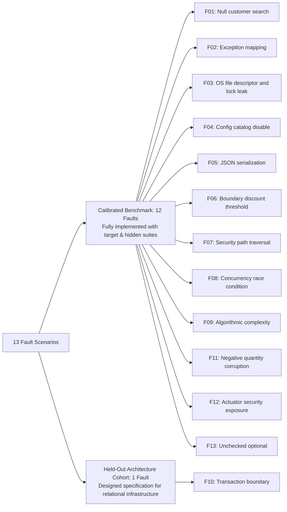
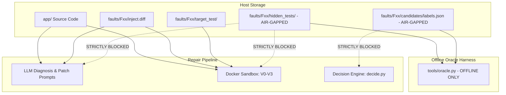

# AutoImmune: Scientific Experiment Protocol & Anti-Leakage Specification

> **Document Version:** 1.0.0  
> **Target Status:** Research Protocol Specification  
> **Protocol Standard:** Leakage-Resistant Benchmarking in Automated Program Repair (APR)

---

## 1. Experimental Design & Objective

The objective of the AutoImmune empirical evaluation is to quantify:
1. **Unsafe Automatic Application Rate:** Proportion of deployed patches that violate hidden specification or security requirements.
2. **Correct Automatic Application Rate:** Proportion of semantically correct patches deployed without human intervention.
3. **Human Intervention Rate (HIR):** Proportion of candidates escalated for human review.
4. **Validation Gate Precision & Incremental Yield:** The specific failure categories intercepted by each successive gate ($V0, V1, V2, V3$).

---

## 2. Leakage-Resistant Data Split

To prevent benchmark overfitting and ensure sound generalizability claims, the 13 faults in the extended catalog are partitioned into two strictly separated sets:

### 2.1 Split Rules
1. **Unit of Splitting:** Splitting is performed strictly at the **fault level**, never by candidate or run.
2. **Implemented Benchmark Cohort (12 Faults):** F01, F02, F03, F04, F05, F06, F07, F08, F09, F11, F12, F13.
   - Fully implemented with reproducible injection diffs, visible target tests, independent hidden oracle suites (specification + performance), diverse candidate cohorts (5–6 diffs each, 61 total diffs), and adjudication metadata.
   - Evaluated under frozen pipeline parameters (`config/decision.yaml`).
3. **Held-Out Architecture Cohort (1 Fault):** F10.
   - Documented specification requiring microservice infrastructure extensions (persistent relational storage with Spring Data JPA and distributed transaction coordinator).

---

## 3. Anti-Leakage & Sandbox Isolation Guarantee

In empirical automated repair research, **data leakage** occurs when test inputs, expected answers, or oracle specifications inadvertently enter the repair pipeline or LLM context. AutoImmune implements an architectural firewall to guarantee zero leakage:

### 3.1 Structural Isolation Rules
1. **Hidden Tests are Excluded from Git & Docker Mounts:**
   - Directory `faults/*/hidden_tests/` is ignored by container mounts.
   - Unit test [`tests/test_sandbox.py`](file:///d:/14/tests/test_sandbox.py) explicitly iterates over mounted directory trees and asserts:
     $$\forall p \in \text{Mounts}: \text{"hidden\_tests"} \notin p \land \text{"labels.json"} \notin p$$
2. **Network Isolation During Gate Execution:**
   - All gate validation containers run with `--network none`.
   - Inbound and outbound socket calls fail with `UnknownHostException` / `Network unreachable` ([`docs/audit/isolation_test.txt`](file:///d:/14/docs/audit/isolation_test.txt)).
   - No test telemetry or candidate data can leak to external LLM providers or remote endpoints during validation.
3. **Prompt Sanitization:**
   - Online LLM prompts (`DIAGNOSE_SYSTEM`, `PATCH_SYSTEM` in [`pipeline/providers.py`](file:///d:/14/pipeline/providers.py)) are supplied exclusively with:
     - The application stack trace or probe error message.
     - The diagnosed source file.
     - The visible target unit test.
   - Prompts **never** contain hidden test source code, expected assertion values, or ground-truth diffs.

---

## 4. Controlled Policy Execution Protocol

For each fault scenario, repair candidates are evaluated under four distinct policies to measure the incremental contribution of each gate:

$$\begin{aligned}
\text{Policy } B_0(c) &= \text{ESCALATE} \quad \forall c \\
\text{Policy } B_1(c) &= \begin{cases} \text{AUTO\_APPLY} & \text{if } V0(c) = \text{pass} \land V1(c) = \text{pass} \\ \text{REJECT} & \text{otherwise} \end{cases} \\
\text{Policy } B_2(c) &= \begin{cases} \text{AUTO\_APPLY} & \text{if } \bigwedge_{i=0}^2 Vi(c) = \text{pass} \\ \text{REJECT} & \text{otherwise} \end{cases} \\
\text{Policy } B_3(c) &= \text{AutoImmune Rule Tier } (V0 \dots V3, \text{Scope, Path, Diff Size})
\end{aligned}$$

### 4.1 Candidate Cohort Separation
- **Scripted Cohort:** Evaluates hand-built candidates (`correct`, `overfitting`, `regressive`, `insecure`, `ineffective`, `slow`). Demonstrates deterministic gate mechanics without stochastic model noise.
- **LLM Cohort:** Evaluates model-generated candidates. Each candidate records model version, prompt hash, temperature, raw response hash, and normalized diff.

---

## 5. Offline Replay & Reproducibility Protocol

1. **Deterministic Cache Hashing:**
   - LLM requests are hashed using SHA-256 over canonical JSON tuples: `[model, system_prompt, user_prompt, temperature, max_tokens]`.
   - Stored in [`cache/<HASH>.json`](file:///d:/14/cache/).
2. **Replay Mode Execution:**
   - Invoked via: `python -m pipeline run --fault <ID> --diag-mode replay --patch-mode replay`.
   - In replay mode, any network request to an LLM provider triggers a hard failure (`ProviderError: Cache miss during replay`).
   - Ensures any third-party researcher can reproduce every live LLM run byte-for-byte without an API key.
