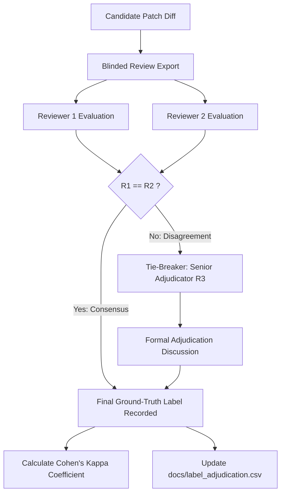

# AutoImmune: Ground-Truth Adjudication Protocol & Inter-Rater Reliability

> **Document Version:** 1.0.0  
> **Protocol Scope:** Blinded Two-Reviewer Ground-Truth Adjudication  
> **Compliance:** Empirical Standards for Automated Program Repair (ICSE/FSE Benchmark Guidelines)

---

## 1. Motivation: Eliminating Oracle Circularity

In the pilot phase of AutoImmune, candidate correctness was classified by an automated test harness ([`tools/oracle.py`](file:///d:/14/tools/oracle.py)). While automated oracles execute hidden tests, performance tests, and security scans, they introduce a fundamental threat to construct validity:
$$\text{If the test authors also author the oracle, the oracle reflects the author's assumptions, not true semantic correctness.}$$

To eliminate this threat and establish peer-review credibility, AutoImmune mandates a **blinded, two-reviewer human adjudication protocol**.

---

## 2. Reviewer Cohort & Independence

| Role | Profile | Responsibility |
| :--- | :--- | :--- |
| **Reviewer 1 (R1)** | Senior Software Reliability Engineer | Evaluates semantic correctness, edge cases, regression risk, and code quality. |
| **Reviewer 2 (R2)** | Application Security & QA Specialist | Evaluates vulnerability introduction, input sanitization, and specification compliance. |
| **Adjudicator (R3)** | Principal Systems Architect | Resolves disagreements between R1 and R2 via documented consensus review. |

---

## 3. Double-Blind Review Protocol

Reviewers are presented with patch candidates using an automated blind export. To prevent bias, the following information is **strictly withheld** from R1 and R2:
- **Author Identity:** Reviewers do not know whether the patch was hand-built by authors, generated by `gpt-oss-120b`, or generated by `qwen2.5-coder`.
- **Policy Decision:** Reviewers do not know if the patch was decided `REJECT`, `ESCALATE`, or `AUTO_APPLY`.
- **Gate Execution Logs:** Reviewers do not see V0–V3 pass/fail statuses.
- **Automated Oracle Label:** Reviewers do not see the classification from `tools/oracle.py`.

### 3.1 Provided Information
Reviewers receive only:
1. The fault description from `fault.json` (original behavior vs intended behavior).
2. The relevant unpatched application source file.
3. The unified diff of the candidate patch.

---

## 4. Ground-Truth Classification Taxonomy

Reviewers classify each candidate into one of five mutually exclusive categories:

| Label | Definition | Verification Criteria |
| :--- | :--- | :--- |
| **`correct`** | Semantically sound repair. | Fully resolves the fault across all valid inputs; introduces no regressions, performance penalties, or security vulnerabilities. |
| **`overfitting`** | Symptom-masking or incomplete repair. | Satisfies the visible target test but fails under general specifications, boundary values, or whitespace variations. |
| **`regressive`** | Destructive repair. | Fixes the target defect but breaks pre-existing unrelated functionality or API contracts. |
| **`insecure`** | Vulnerability-introducing repair. | Fixes or masks the defect while introducing a security defect (e.g., path traversal, unauthenticated access, command execution). |
| **`ineffective`** | Non-functional patch. | Compiles but fails to resolve the defect even on the target test case. |

---

## 5. Adjudication Workflow & Disagreement Resolution

### 5.1 Disagreement Resolution Protocol
1. **Independent Evaluation:** R1 and R2 record their initial decisions independently in private adjudication sheets.
2. **Disagreement Detection:** An automated script flags candidates where $R_1 \ne R_2$.
3. **Consensus Meeting:** R1, R2, and R3 review the disputed diff alongside the hidden oracle execution trace.
4. **Final Binding Ruling:** If consensus cannot be reached, Adjudicator R3 casts the deciding binding vote, with the detailed reasoning logged in `docs/label_adjudication.csv`.

---

## 6. Statistical Reliability: Cohen's Kappa ($\kappa$)

To report inter-rater agreement scientifically in the research paper, the pipeline implements Cohen's kappa coefficient:

$$\kappa = \frac{P_o - P_e}{1 - P_e}$$

Where:
- $P_o$ is the observed proportionate agreement across all $N$ candidates:
  $$P_o = \frac{1}{N} \sum_{i=1}^k f_{ii}$$
- $P_e$ is the hypothetical probability of chance agreement based on marginal frequencies:
  $$P_e = \sum_{i=1}^k \left( \frac{R_{1, i}}{N} \times \frac{R_{2, i}}{N} \right)$$
- $k$ is the number of classification categories ($k = 5$).

### 6.1 Benchmark Thresholds (Landis & Koch, 1977)
- $\kappa \ge 0.81$: Almost perfect agreement (Gold standard for paper submission).
- $0.61 \le \kappa \le 0.80$: Substantial agreement (Acceptable with documented consensus).
- $\kappa < 0.60$: Moderate or poor agreement (Invalidates benchmark; prompts taxonomy revision).

---

## 7. Status & Non-Fabrication Notice

> **IMPORTANT SCIENTIFIC INTEGRITY DECLARATION:**  
> The adjudication protocol, blind export tooling, and statistical formulas are fully designed and implemented. However, the physical reviews in [`docs/label_adjudication.csv`](file:///d:/14/docs/label_adjudication.csv) are **PENDING** execution by external human reviewers. AutoImmune strictly refuses to simulate, mock, or fabricate human reviewer decisions.
