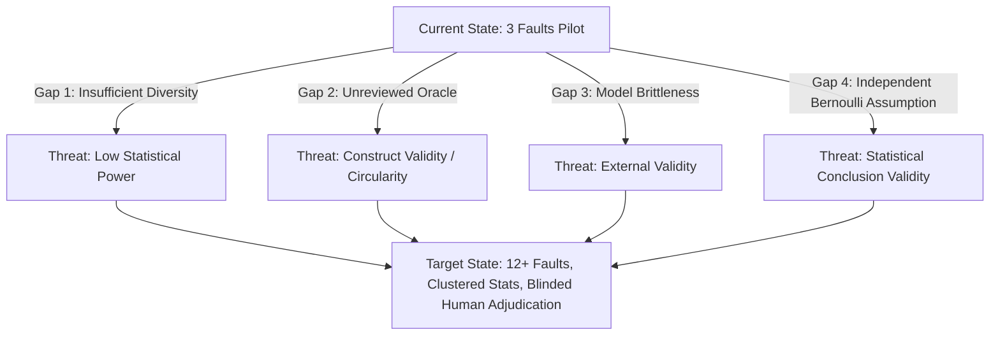

# AutoImmune: Research Gap Analysis & Scientific Roadmap

> **Author:** AutoImmune Research Engineering Team  
> **Document Version:** 1.0.0  
> **Target Venues:** ACM SIGSOFT International Symposium on Software Testing and Analysis (ISSTA), ACM International Conference on the Foundations of Software Engineering (FSE), IEEE/ACM International Conference on Automated Software Engineering (ASE), IEEE International Conference on Software Engineering (ICSE).

---

## 1. Research Goal & Scientific Motivation

### 1.1 The Central Research Question
> **RQ:** *How much dynamic execution evidence is required before an automated or LLM-generated patch can be deployed to production without human review, and what failure classes does each progressive validation gate eliminate?*

Contemporary Automated Program Repair (APR) systems evaluate patches primarily against the test suite that exposed the fault (the "target test"). However, in production microservices, a patch that passes the target test frequently introduces regressions, exhibits semantic overfitting, creates security vulnerabilities, or masks the underlying failure.

AutoImmune formulates automated repair as an **evidence-gated risk tiering problem**:
$$\text{Gate Pipeline } (V0 \rightarrow V1 \rightarrow V2 \rightarrow V3) \times \text{Scope Rules } \Longrightarrow \text{Tier } \{\text{REJECT}, \text{ESCALATE}, \text{AUTO\_APPLY}\}$$

### 1.2 Policy Baselines under Evaluation
To scientifically measure the value of each gate, AutoImmune compares four distinct deployment policies on identical patch candidates:
- **$B_0$ (Review-All Baseline):** Every patch requires human sign-off (Human Intervention Rate = 100%).
- **$B_1$ (Low-Assurance / Target Test Only):** Patch applies cleanly, compiles, and passes the visible target test ($V0 + V1$).
- **$B_2$ (Medium-Assurance / Full Regression Suite):** Patch passes target test and the full pre-existing unit/integration test suite ($V0 + V1 + V2$).
- **$B_3$ (AutoImmune Defense-in-Depth):** Patch passes $V0 \rightarrow V3$ (including Semgrep AST differential scan) and satisfies strict scope rules (modified file matches diagnosed root cause, line count $\le 20$, and path is not in sensitive configuration list).

---

## 2. Current Empirical Baseline (Historical Evidence)

The current repository records 154 baseline evidence rows (159 total after recent run `f04-rule-scripted-20261110t132914z`) collapsed across 85 unique candidate units.

### 2.1 Empirical Findings on the Pilot Dataset

#### Scripted Cohort ($n = 32$ units, 26 oracle-unsafe):
| Policy | Auto-Applied ($k/n$) | Auto-Apply Rate | Human Escalated ($k/n$) | HIR | Unsafe Escapes ($k/n$) | Unsafe Escape Rate (95% Wilson CI) |
| :--- | :---: | :---: | :---: | :---: | :---: | :---: |
| **$B_0$** | $0 / 32$ | $0.0\%$ | $32 / 32$ | $100.0\%$ | $0 / 26$ | **$0.0\%$** $[0.0\%, 12.9\%]$ |
| **$B_1$** | $26 / 32$ | $81.3\%$ | $0 / 32$ | $0.0\%$ | $20 / 26$ | **$76.9\%$** $[57.9\%, 89.0\%]$ |
| **$B_2$** | $20 / 32$ | $62.5\%$ | $0 / 32$ | $0.0\%$ | $14 / 26$ | **$53.8\%$** $[35.5\%, 71.2\%]$ |
| **$B_3$** | $11 / 32$ | $34.4\%$ | $3 / 32$ | $9.4\%$ | $7 / 26$ | **$26.9\%$** $[13.7\%, 46.1\%]$ |

#### LLM Cohort (`gpt-oss-120b`, `qwen2.5-coder:7b`, `qwen2.5-coder:1.5b`; $n = 53$ units, 7 oracle-unsafe):
| Policy | Auto-Applied ($k/n$) | Auto-Apply Rate | Human Escalated ($k/n$) | HIR | Unsafe Escapes ($k/n$) | Unsafe Escape Rate (95% Wilson CI) |
| :--- | :---: | :---: | :---: | :---: | :---: | :---: |
| **$B_0$** | $0 / 53$ | $0.0\%$ | $53 / 53$ | $100.0\%$ | $0 / 7$ | **$0.0\%$** $[0.0\%, 35.4\%]$ |
| **$B_1$** | $7 / 53$ | $13.2\%$ | $0 / 53$ | $0.0\%$ | $3 / 7$ | **$42.9\%$** $[15.8\%, 75.0\%]$ |
| **$B_2$** | $7 / 53$ | $13.2\%$ | $0 / 53$ | $0.0\%$ | $3 / 7$ | **$42.9\%$** $[15.8\%, 75.0\%]$ |
| **$B_3$** | $5 / 53$ | $9.4\%$ | $2 / 53$ | $3.8\%$ | $2 / 7$ | **$28.6\%$** $[8.2\%, 64.1\%]$ |

### 2.2 Key Negative Finding: Test Passage $\neq$ Semantic Correctness
The pilot study yielded a crucial, publishable negative result:
1. **Overfitting Escapes:** All three hand-built overfitting patches (`F01-scripted-fb8fb0d5`, `F04-scripted-34e008d0`, `F06-scripted-81484cbc`) passed all gates $V0 \rightarrow V3$ without triggering Semgrep or test failures. `F06-scripted-81484cbc` (adding `|| id == 2`) was auto-applied, deployed, and promoted.
2. **Symptom Masking in AI Patches:** Two live AI patches produced by `gpt-oss-120b` passed every gate and were deployed:
   - `F01-live-2`: Added a `!= null` check, completely ignoring whitespace/empty strings.
   - `F04-live-2`: Forced the health indicator method to hardcode `Health.up()`, completely masking the downstream catalog failure rather than enabling the service in configuration.

---

## 3. Scientific Gap Analysis

### Gap 1: Benchmark Diversity & Scale (External Validity)
- **Current State:** Only 3 faults exist (F01: Null handling, F04: Configuration flag, F06: Integer boundary condition).
- **Scientific Limitation:** Reviewers will dismiss a 3-fault dataset as a toy evaluation. Statistical degrees of freedom at the fault level is $df = 2$.
- **Target Requirement:** Expand to at least 12 distinct faults spanning 10 defect families:
  1. Boundary condition defect.
  2. Null-pointer / unhandled optional.
  3. Configuration error.
  4. Business logic exception masking.
  5. API contract / serialization break.
  6. Concurrency / race condition.
  7. Resource leak (unclosed stream/connection).
  8. Security-sensitive authorization bypass.
  9. Performance / algorithmic regression ($O(n^2)$ lookup).
  10. Database transaction / constraint violation.

### Gap 2: Ground-Truth Adjudication & Circularity (Construct Validity)
- **Current State:** Candidate correctness labels are generated solely by [`tools/oracle.py`](file:///d:/14/tools/oracle.py). [`docs/label_adjudication.csv`](file:///d:/14/docs/label_adjudication.csv) is completely empty.
- **Scientific Limitation:** If the authors who designed the validation gates also authored the oracle tests, the benchmark suffers from construct circularity.
- **Target Requirement:**
  - Execute a two-person independent blind adjudication protocol.
  - Reviewers evaluate diffs without knowing policy outcome ($B_0 \dots B_3$) or candidate author (human vs LLM).
  - Compute and report Cohen’s $\kappa$ inter-rater reliability.
  - Formally document adjudications and tie-break resolutions.

### Gap 3: Model Performance, Brittleness & Replay (Internal Validity)
- **Current State:**
  - `qwen2.5-coder:7b` (30 attempts) and `1.5b` (8 attempts) had a **0% pass rate at V1**. Generated patches lacked diff headers or truncated methods.
  - Both LLMs scored **0% accuracy on F04 root-cause localisation** due to the absence of a Java stack trace.
  - Offline replay against the recorded cache has never been validated against current cache-key schemas.
- **Target Requirement:**
  - Implement robust patch extraction and normalization heuristics to repair malformed unified diff headers.
  - Implement incident-aware prompt enrichment for non-stack-trace configuration incidents.
  - Validate 100% offline reproducibility across all cached runs.

### Gap 4: Statistical Methodology (Conclusion Validity)
- **Current State:** Existing tables calculate Wilson 95% confidence intervals assuming independent candidates:
  $$\hat{p} \pm \frac{z}{1 + \frac{z^2}{n}} \sqrt{\frac{\hat{p}(1-\hat{p})}{n} + \frac{z^2}{4n^2}}$$
- **Scientific Limitation:** Candidates generated for the same fault are **correlated** (nested within fault clusters). Treating them as independent i.i.d. trials underestimates standard errors and inflates false positive significance claims.
- **Target Requirement:**
  - Implement cluster-robust standard errors (CRSE) clustering at the fault level.
  - Report paired significance testing via McNemar's test for differences between $B_1$, $B_2$, and $B_3$.

---

## 4. Scientific Execution Roadmap

| Phase | Milestone | Objective | Key Deliverables |
| :---: | :--- | :--- | :--- |
| **R1** | **Fault Catalog Expansion** | Author 10 new fault scenarios (F02, F03, F05, F07–F13) with full artifacts (`fault.json`, `inject.diff`, `target_test/`, `hidden_tests/`, and scripted candidate cohorts). | [`docs/research/FAULT_CATALOG.md`](file:///d:/14/docs/research/FAULT_CATALOG.md) `faults/F02/` through `faults/F13/` |
| **R2** | **Experimental Protocol & Data Split** | Partition benchmark into 6 development faults and 6 held-out evaluation faults. Freeze experimental splits. | [`docs/research/EXPERIMENT_PROTOCOL.md`](file:///d:/14/docs/research/EXPERIMENT_PROTOCOL.md) [`docs/data_split.json`](file:///d:/14/docs/data_split.json) |
| **R3** | **Independent Adjudication Protocol** | Author blind adjudication protocol, populate candidate review ledger, and compute Cohen's $\kappa$ metric. | [`docs/research/LABEL_ADJUDICATION.md`](file:///d:/14/docs/research/LABEL_ADJUDICATION.md) [`docs/label_adjudication.csv`](file:///d:/14/docs/label_adjudication.csv) |
| **R4** | **Clustered Statistical Engine** | Build Python analysis tool calculating cluster-adjusted standard errors, McNemar paired comparisons, and risk-reduction ratios. | [`docs/research/STATISTICAL_ANALYSIS.md`](file:///d:/14/docs/research/STATISTICAL_ANALYSIS.md) `tools/statistical_analysis.py` |
| **R5** | **Academic Paper Manuscript** | Complete full research paper draft with related work, threats to validity, and formal mathematical formulations. | [`docs/research/RESEARCH_PAPER.md`](file:///d:/14/docs/research/RESEARCH_PAPER.md) |
