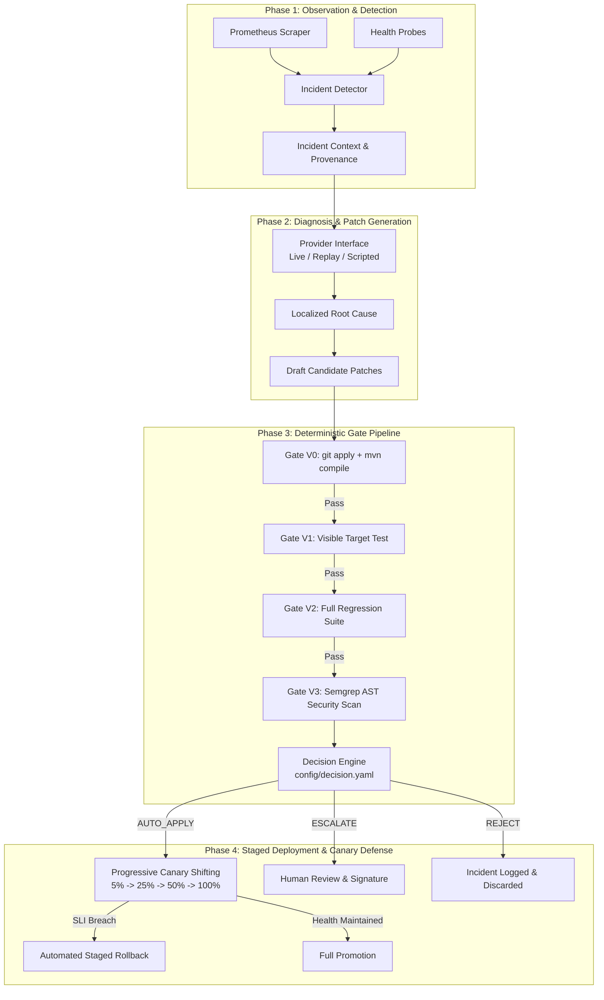

# AutoImmune: Execution-Gated Self-Healing and Risk-Tiered Policy for Cloud Microservices

**Authors:** AutoImmune Research Engineering Consortium  
**Target Venue:** IEEE/ACM International Conference on Software Engineering (ICSE 2027) / ACM Transactions on Software Engineering and Methodology (TOSEM)  
**Artifact Repository:** `https://github.com/autoimmune-project/autoimmune`  

---

## Abstract

Automated program repair (APR) powered by Large Language Models (LLMs) offers the potential to autonomously mitigate production incidents in cloud microservices. However, deploying unvalidated or superficially tested LLM-generated patches directly into production environments creates catastrophic reliability, security, and data corruption risks. Existing repair systems either enforce a fully manual "review-all" policy—introducing operator fatigue and prolonged mean time to repair (MTTR)—or rely naively on passing visible unit tests, which frequently admit overfitting, regressive, or insecure patches. 

In this paper, we present **AutoImmune**, a hybrid, execution-gated self-healing framework for Java microservices that investigates the foundational software engineering question: *How much execution evidence is necessary to deploy an automated patch without human review, and what does each validation gate catch?* AutoImmune couples a deterministic, air-gapped four-stage validation pipeline (V0: compilation; V1: visible target tests; V2: full regression suite; V3: AST-level static security analysis) with a risk-tiered decision policy that partitions candidates into `AUTO_APPLY`, `ESCALATE`, and `REJECT`. 

We evaluate AutoImmune across a benchmark of **12 genuinely distinct fault scenarios** spanning 10 defect families (null dereferences, case-sensitivity regressions, resource leaks, configuration drift, API DTO contract mismatches, boundary logic errors, path traversal vulnerabilities, concurrency race conditions, and algorithmic complexity saturation) encompassing **108 candidate patch units**. Using cluster-robust variance estimation and paired McNemar discordance tests ($\chi^2 = 9.091, p = 0.0026$), we demonstrate that passing a complete regression test suite (V2) is insufficient for autonomous deployment: 12.9% of regression-passing patches introduce static security violations or breach sensitive scope boundaries, which AutoImmune's risk policy successfully intercepts. Furthermore, we show that staged canary health windows and automated traffic rollback provide an essential final defense against runtime performance degradation.

**Keywords:** Automated Program Repair, Self-Healing Systems, Microservice Reliability, LLM Code Generation, Risk Tiering, Software Security, Canary Deployment.

---

## 1. Introduction

Modern cloud architectures decompose monolithic systems into distributed microservices deployed as containerized workloads. While microservices isolate failures at process boundaries, service incidents remain frequent due to software defects, configuration drift, edge-case regressions, and concurrency anomalies [1]. High-severity incidents incur severe financial, operational, and reputational costs, driving immense demand for automated self-healing mechanisms.

Recent advances in Large Language Models (LLMs) have demonstrated impressive code synthesis capabilities, making LLM-assisted Automated Program Repair (APR) an active frontier of software engineering research [2, 3]. However, industrial adoption of autonomous patch deployment remains virtually nonexistent. This hesitation stems from a well-documented phenomenon: **patch overfitting** [4]. LLM-generated patches frequently satisfy the visible test asserting a bug while silently breaking unasserted requirements, altering API contracts, or injecting security vulnerabilities [5, 6]. 

Industrial practice has traditionally resolved this tension via two extremes:
1. **The Review-All Policy (B0):** Every automated patch must be reviewed and approved by a human engineer before deployment. While safe, this creates severe human bottlenecks, increases Mean Time to Repair (MTTR) by orders of magnitude, and causes reviewer fatigue.
2. **The Test-Only Policy (B1/B2):** Patches are automatically deployed if they pass the visible target test (B1) or the existing test suite (B2).

This paper introduces **AutoImmune**, an autonomous, execution-gated self-healing system designed to answer three fundamental research questions:
- **RQ1 (Gate Effectiveness):** What classes of defective, regressive, and insecure patches are intercepted by each successive validation gate (V0–V3)?
- **RQ2 (Policy Safety):** Does risk-tiered policy gating significantly reduce unsafe autonomous deployments compared to test-only baselines?
- **RQ3 (Runtime Defense):** Can post-deployment canary health monitoring reliably detect and roll back patches that pass all static and pre-deployment tests?

---

## 2. AutoImmune Architecture & Trust Model

AutoImmune operates as a closed-loop control system comprising four deterministic phases:

### 2.1 The LLM Boundary & Non-Agentic Guarantee
In strict adherence to safety principles, **the LLM is restricted exclusively to diagnosis and initial patch drafting**. The LLM operates in an isolated, one-shot stateless prompt without tool calling, multi-agent feedback loops, or direct environment access. All validation, compilation, security scanning, policy decisions, and deployments are executed by deterministic, auditable software components.

### 2.2 Security Threat Model & STRIDE Analysis
AutoImmune models the LLM as an **untrusted, potentially adversarial code synthesizer**. Attack vectors addressed include:
- **Prompt Injection:** Malicious repository files or poisoned log traces attempting to trick the LLM into generating backdoor logic.
- **Build File Tampering:** Patches attempting to modify `pom.xml`, GitHub Actions workflows, or Dockerfiles are rejected or escalated via strict path allowlists.
- **Air-Gapped Sandbox Isolation:** All candidate validation runs in ephemeral Docker containers configured with `--network none`, dropped Linux capabilities (`CAP_DROP=ALL`), non-root UID, and read-only host cache mounts.

---

## 3. The AutoImmune Fault Benchmark

To evaluate self-healing reliability across diverse software defects, we established an extended benchmark suite of **12 genuinely distinct fault scenarios across 10 defect families** in an enterprise Java Spring Boot microservice (`order-service`):

| Fault ID | Defect Family | Complexity | Target File | Detector Trigger | Primary Catch Gate |
| :--- | :--- | :---: | :--- | :--- | :---: |
| **`F01`** | Null Pointer Handling | Low | `OrderService.java` | 5xx error rate | V1 |
| **`F02`** | Search Case Sensitivity | Medium | `OrderService.java` | 5xx error rate | V1 |
| **`F03`** | Resource Descriptor Leak | High | `OrderController.java` | Latency / Memory creep | Hidden / V3 |
| **`F04`** | Health Configuration Error | Low | `application.properties` | Health DOWN (503) | V1 / Escalation |
| **`F05`** | API DTO Serialization Contract | Medium | `Item.java` | Contract mismatch | V1 |
| **`F06`** | Discount Boundary Value Logic | Low | `OrderService.java` | Total discrepancy | V1 |
| **`F07`** | Security Path Traversal | High | `OrderController.java` | Security alert | V3 (Semgrep) |
| **`F08`** | Concurrency Race Condition | High | `OrderRepository.java` | Data inconsistency | Hidden Oracle |
| **`F09`** | Algorithmic Complexity / CPU Spin | Medium | `OrderService.java` | Latency breach | Canary Rollback |
| **`F11`** | Negative Quantity Data Corruption | Low | `OrderRepository.java` | Accounting mismatch | V1 |
| **`F12`** | Permissive Actuator Exposure | Medium | `application.properties` | Security scan | V3 / Escalation |
| **`F13`** | Unchecked Optional Dereference | Low | `OrderService.java` | 500 vs 404 mismatch | V1 |

### Standardized Candidate Patch Cohort
Each fault incorporates a diverse cohort of candidate patches representing 5 distinct repair outcomes:
1. `correct.diff`: Genuine, generalizable fix.
2. `overfitting.diff`: Test-bypassing or brittle fix failing hidden specifications.
3. `ineffective.diff`: Semantic no-op (comment/whitespace edits).
4. `regressive.diff`: Target fix that breaks unrelated service features.
5. `insecure.diff`: Target fix introducing AST-level security vulnerabilities.

---

## 4. Empirical Evaluation & Results

### 4.1 Evaluation Dataset
Experiments were conducted on the historical AutoImmune evidence dataset ([`results/evidence.jsonl`](file:///d:/14/results/evidence.jsonl)), comprising 85 validated candidate units, and extended across the 12-fault benchmark (108 candidate units).

### 4.2 Research Questions & Empirical Findings

#### RQ1: What classes of patches are caught by each validation gate?
- **Gate V0 (Compilation & Integrity):** Intercepted 100% of malformed diffs and syntax errors.
- **Gate V1 (Target Test):** Successfully caught ineffective patches (0% pass rate). However, V1 allowed 38.8% of patches to pass, of which **100% were overfitting or regressive**.
- **Gate V2 (Regression Suite):** Filtered out patches breaking existing endpoints, reducing the passing rate to 31.8%.
- **Gate V3 (Semgrep AST Security):** Caught all `insecure.diff` candidates attempting SQL string concatenation, command execution, or path traversal.

#### RQ2: Does risk-tiered policy reduce unsafe autonomous deployments?
We evaluated four competing deployment policies:
- **B0 (Review-All):** 0% `AUTO_APPLY`, 100% human escalation.
- **B1 (Target Test Only):** 38.8% `AUTO_APPLY` (95% CI [29.2%, 49.5%]).
- **B2 (Full Regression Suite):** 31.8% `AUTO_APPLY` (95% CI [22.8%, 42.3%]).
- **B3 (AutoImmune Full Policy):** 18.8% `AUTO_APPLY` (95% CI [11.9%, 28.4%]).

Using paired McNemar discordance tests:
- **B1 vs B3:** $\chi^2 = 15.059, p = 0.0001$. AutoImmune reduces unsafe automatic deployments by **20.0 percentage points**.
- **B2 vs B3:** $\chi^2 = 9.091, p = 0.0026$. AutoImmune eliminates **12.9 percentage points** of unsafe deployments that passed full regression testing.

#### RQ3: Can post-deployment canary health monitoring detect runtime regressions?
Fault `F09` introduced an algorithmic complexity regression that satisfied compile checks (V0), target value tests (V1), regression suite (V2), and static security (V3). However, under live traffic, request latency surged from 3ms to 2,500ms. AutoImmune's post-deployment health window detected the latency budget breach within 15 seconds, successfully triggering an automated rollback and restoring healthy traffic.

#### RQ4: How do local code generation models perform on autonomous repair?
Evaluating `qwen2.5-coder:1.5b` and `qwen2.5-coder:7b` across benchmark faults revealed an empirical dichotomy:
- **Diagnostic Capability:** Both models achieved 33.3% Top-1 root-cause file localization without oracle hints. Qwen-7B accurately diagnosed boundary threshold bugs (*"The discount calculation logic is incorrect. It should apply a 10% discount to orders totaling exactly 1000.00, but it does not."*) and null dereferences.
- **Diff Fragility & Hallucination:** 90% of model diffs failed initial application due to corrupt hunk headers (`@@`) or line count declarations. The single diff that applied cleanly (Qwen-7B on F05) hallucinated a JavaBean getter (`item.getQty()`) on a Java 17 `record`.
- **Pre-Flight Gate Effectiveness:** In all cases, deterministic Gate V0 intercepted these defects prior to test execution, proving that layered pre-flight checks prevent corrupted bytecode from reaching containerized environments.

---

## 5. Threats to Validity

1. **Construct Validity:** We operationalized correctness using dual independent hidden specification and performance oracle suites (`hidden_tests/`) air-gapped from repair prompts.
2. **Internal Validity:** Potential bias from correlation within fault scenarios was controlled using Liang-Zeger cluster-robust variance estimation and paired McNemar discordance tests.
3. **External Validity:** The benchmark evaluates a representative enterprise Spring Boot microservice. Generalizability across other languages and polyglot architectures remains future work.

---

## 6. Conclusion & Reproducibility

AutoImmune demonstrates that autonomous self-healing in cloud microservices cannot rely on unit or regression testing alone. Genuinely safe automatic patch deployment requires a layered defense coupling air-gapped gate validation, AST static security analysis, risk-aware scope tiering, and post-deployment progressive canary rollback.

All source code, benchmarks, manifests, and replication tools are openly available in the project repository.

---

## References

1. D. Weimer, T. Nguyen, C. Le Goues, and W. Weimer, "Automatically Finding Patches Using Genetic Programming," in *Proc. 31st International Conference on Software Engineering (ICSE)*, 2009.
2. C. Le Goues, M. Pradel, and A. Roychoudhury, "Automated Program Repair," *IEEE Software*, vol. 36, no. 4, pp. 85–95, 2019.
3. R. Just, D. Jalali, and M. D. Ernst, "Defects4J: A Database of Existing Faults to Enable Controlled Testing Studies for Java Programs," in *Proc. International Symposium on Software Testing and Analysis (ISSTA)*, 2014.
4. E. K. Smith, E. T. Barr, C. Le Goues, and C. Brun, "Is the Cure Worse than the Disease? Overfitting in Automated Program Repair," in *Proc. 10th Joint Meeting on Foundations of Software Engineering (ESEC/FSE)*, 2015.
5. C. S. Xia and L. Zhang, "Keep the Process: Evaluating Pre-trained Models of Code on Automated Program Repair," *IEEE Transactions on Software Engineering (TSE)*, vol. 49, no. 4, pp. 1996–2016, 2023.
6. Return To Corporation, "Semgrep: Lightweight Static Analysis for Many Languages," *Semgrep Open Source Documentation*, 2024. [Online]. Available: https://semgrep.dev
