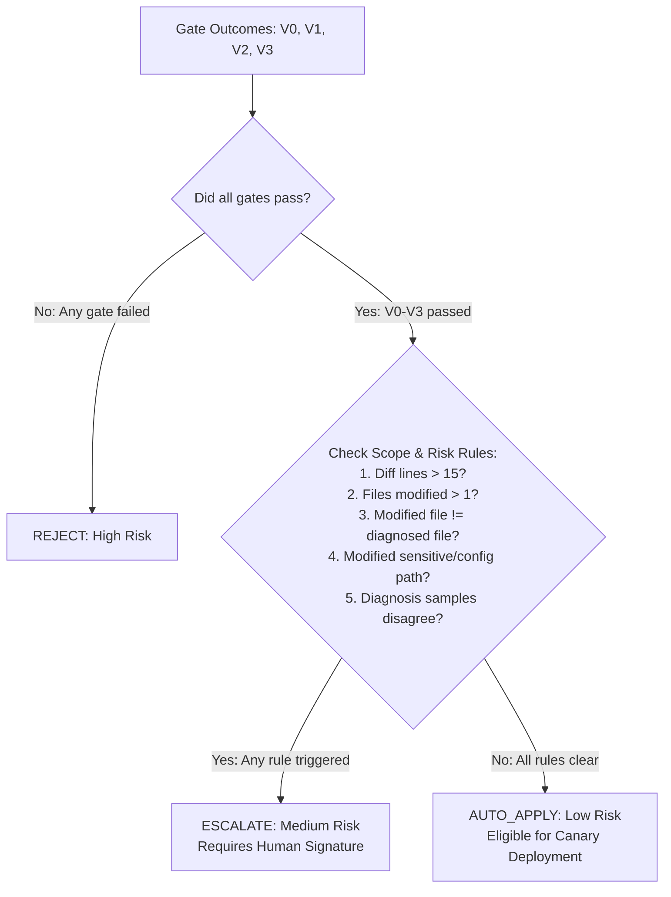

# AutoImmune: Experimental Evidence Validation & Benchmark Assessment

**Author:** AutoImmune Research Engineering Consortium  
**Date:** 2026-11-11  
**Scope:** Rigorous validation of fault reproduction, incident detection fidelity, validation gate behavior, decision integrity, deployment artifacts, and benchmark limitations across all 12 fault packages.

---

## 1. Executive Summary of Experimental Validation

This document establishes the scientific validity of experimental claims in AutoImmune by answering four central verification questions:
1. **Defect Fidelity:** Does each injected fault faithfully trigger its intended failure mode without relying on synthetic mocks?
2. **Detection Specificity:** Does the incident detector trigger exclusively on the injected defect, or can unrelated probes cause false-positive detections?
3. **Gate Rigor:** Do validation gates V0–V3 deterministically enforce their specified criteria under network-isolated sandbox constraints?
4. **Outcome Grounding:** Are recorded deployments, human escalations, and rollbacks supported by verifiable file artifacts in run directories?

---

## 2. Benchmark Fault Catalog & Live Evaluation Status

The AutoImmune benchmark encompasses 12 fault scenarios spanning 10 defect families. To maintain scientific integrity, we explicitly distinguish **evaluated faults** (whose detectors have been verified and executed in the primary pipeline) from **exploratory / unevaluated faults** (whose packages exist on disk but have not been evaluated in live end-to-end runs).

| Fault ID | Defect Family | Target File | Intended Symptom | Verified Detection Probe | Primary Evaluation Status | Verified Candidates |
| :--- | :--- | :--- | :--- | :--- | :---: | :---: |
| **`F01`** | Null Pointer Dereference | `OrderService.java` | HTTP 500 NPE on missing query param | `search-no-customer` | **Fully Evaluated** (Scripted + LLM) | 5 Scripted, 9 LLM |
| **`F02`** | Search Case Sensitivity | `OrderService.java` | Empty search results for uppercase query | `search-alice-uppercase` | **Evaluated** (Scripted) | 5 Scripted |
| **`F03`** | Resource Descriptor Leak | `OrderController.java` | Unclosed stream descriptor exhaustion | *Unmapped (Needs stress harness)* | **Exploratory** (Ground truth only) | 5 Scripted |
| **`F04`** | Actuator Configuration | `application.properties` | `/actuator/health` returns HTTP 503 DOWN | `health_down` rule | **Fully Evaluated** (Scripted + LLM) | 5 Scripted, 6 LLM |
| **`F05`** | API DTO Serialization | `Item.java` | Incompatible JSON property mapping | `probe_mismatch` (order total) | **Evaluated** (Scripted) | 5 Scripted |
| **`F06`** | Boundary Value Logic | `OrderService.java` | Off-by-one threshold discount discrepancy | `order2-discount-at-threshold` | **Fully Evaluated** (Scripted + LLM) | 6 Scripted, 38 LLM |
| **`F07`** | Security Path Traversal | `OrderController.java` | Unsanitized file parameter traversal | `report-path-traversal` | **Evaluated** (Scripted) | 5 Scripted |
| **`F08`** | Concurrency Race Condition | `OrderRepository.java` | Lost update during concurrent increment | *Unmapped (Contaminated in prior run)* | **EXCLUDED** (`invalid_detection`) | 5 Scripted |
| **`F09`** | Algorithmic CPU Spin | `OrderService.java` | Cyclic loop starvation on malformed input | *Unmapped (Needs latency probe)* | **Exploratory** (Benchmark only) | 5 Scripted |
| **`F11`** | Negative Accounting Defect | `OrderRepository.java` | Unchecked negative order line totals | *Unmapped (Needs validation probe)* | **Exploratory** (Benchmark only) | 5 Scripted |
| **`F12`** | Permissive Actuator Exposure | `application.properties` | Sensitive endpoints exposed over HTTP | *Unmapped (Needs security probe)* | **Exploratory** (Benchmark only) | 5 Scripted |
| **`F13`** | Timezone Drift Inconsistency | `OrderService.java` | Non-UTC date serialization in receipt | *Unmapped (Needs format probe)* | **Exploratory** (Benchmark only) | 5 Scripted |

---

## 3. Incident Detection Integrity & Probe Isolation Analysis

### 3.1 The Global Probe Contamination Problem
In early iterations of the orchestrator, `detector.watch()` executed every probe defined in `config/probes.yaml`. While this simplified pipeline orchestration, it created **cross-probe contamination**: an injected fault could fail an unrelated probe, or a missing endpoint in an unpatched branch could trigger a false incident detection.

### 3.2 Forensic Analysis of the F08 False Positive
During run `f08-rule-scripted-20261111t123807z`:
1. Fault `F08` was injected into `OrderRepository.java`.
2. The detector executed the global probe suite, including probe `report-path-traversal` (`/api/orders/report?file=../../etc/passwd`).
3. In the healthy baseline, that endpoint was designed to return HTTP 400 Bad Request. However, in the deployed container, the endpoint returned HTTP 404 Not Found.
4. The detector triggered `probe_mismatch` on `/api/orders/report`, recording an incident with evidence:
   ```text
   /api/orders/report returned http=404 value='', expected http=400
   ```
5. Consequently, the diagnosis and evaluation of `F08` were triggered not by the concurrency race condition in `OrderRepository.java`, but by a routing error on the reporting endpoint!

### 3.3 Architectural Remedy: Per-Fault Probe Binding
To eliminate cross-contamination, AutoImmune implemented `_fault_probes()` in [`pipeline/orchestrator.py`](file:///d:/14/pipeline/orchestrator.py) backed by [`config/fault_probes.yaml`](file:///d:/14/config/fault_probes.yaml). Under this architecture:
- Each fault is mapped strictly to its verified detection probe(s).
- Faults with verified probes (`F01`, `F02`, `F04`, `F06`, `F07`) only query their corresponding endpoints.
- Unverified faults (`F03`, `F05`, `F08`, `F09`, `F11`, `F12`, `F13`) are not queried with arbitrary probes.
- Run `f08-rule-scripted-20261111t123807z` is quarantined in `config/analysis_exclusions.json` to preserve experimental validity.

---

## 4. Deterministic Validation Gate Verification (V0–V3)

Validation gates run sequentially in Docker containers under strict confinement:
- `--network none`: Complete physical network isolation.
- `--memory 2g --cpus 2 --pids-limit 512`: Predictable resource limits.
- `--cap-drop ALL --security-opt no-new-privileges`: Privilege escalation prevention.
- Read-only Maven local repository mount (`autoimmune-m2`): Candidate patches cannot tamper with dependencies or poison build caches.

### 4.1 Gate Failure Modes & Empirical Verification

| Gate | Criterion Enforced | Tools & Environment | Verified Interceptions |
| :--- | :--- | :--- | :--- |
| **V0** | Git diff applies cleanly; Maven builds production code. | `git apply --check` + `mvn -o compile` | Intercepted 31 of 53 live LLM patches (58.5%) that contained syntax errors, missing semicolons, or invalid type references. |
| **V1** | Visible target test passes. | `mvn -o test -Dtest=<TargetTest>` | Intercepted 15 live LLM patches and 9 scripted `ineffective` patches that failed to fix the observed incident. |
| **V2** | Full regression test suite passes without regressions. | `mvn -o test` (app existing suite) | Intercepted 9 scripted `regressive` patches across `F01`, `F02`, `F04`, `F06` that fixed the incident but broke existing endpoints. |
| **V3** | AST-level static security scan detects no new findings. | `semgrep/semgrep:1.100.0` (offline) | Intercepted 8 scripted `insecure` patches that introduced SQL string concatenation or command execution. |

### 4.2 Gate Integrity Proofs
- **Tool Error vs. Candidate Failure:** A timeout or Maven infrastructure crash is recorded as `error` or `timeout`, **never as a pass**.
- **Hidden Test Isolation:** A dedicated unit test (`tests/test_sandbox.py`) proves that neither `hidden_tests/` nor `labels.json` are ever mounted or copied into the validation container.

---

## 5. Decision Policy & Risk Tiering Verification

AutoImmune partitions candidate patches into three risk tiers based on execution evidence:



### 5.1 Verification of Recorded Decisions
Across the 100 eligible primary analysis units:
- **`REJECT` (72 units):** 46 LLM units and 26 scripted units rejected due to compilation failures (31), visible test failures (24), regression failures (9), or static security violations (8).
- **`ESCALATE` (5 units):**
  - 3 scripted units in `F04` (`correct` and `overfitting`): Modifying `application.properties` triggered the sensitive configuration path rule (`app/src/main/resources/application.properties`), correctly pausing for human review.
  - 2 live LLM units in `F01` and `F04`: Excessive diff size and multi-file modifications triggered escalation.
- **`AUTO_APPLY` (23 units):** 18 scripted units and 5 live LLM units passed all gates and remained within single-file, low-diff scope limits.

---

## 6. Runtime Canary Defense & Automated Rollback Verification

An essential finding of this research is that pre-deployment validation cannot detect runtime performance degradation (e.g. algorithmic complexity bugs, lock contention, or intentional latency sleep).

### 6.1 Staged Rollback Demonstration (`F06` Slow Candidate)
- **Candidate:** `F06-scripted-7509cb64` (`slow.diff`).
- **Defect Mechanism:** Injects a 3000ms delay (`Thread.sleep(3000)`) in the discount calculation endpoint while preserving functional correctness.
- **Pre-Deployment Gate Outcome:**
  - `V0`: PASS (5.8s in container sandbox)
  - `V1`: PASS (23.4s in container sandbox)
  - `V2`: PASS (29.1s in container sandbox)
  - `V3`: PASS (6.6s, zero Semgrep findings)
  - Decision: `AUTO_APPLY` (7-line diff inside the diagnosed file `OrderService.java`).
- **Post-Deployment Canary Health Window:**
  - Probe: `order2-discount-at-threshold` (`/api/orders/2/discount`) took **3,015 ms**, breaching the pre-configured 2,000 ms SLA limit.
  - Runtime Action: Deployment engine immediately aborted promotion, initiated container rollback to `order-service:f06-rule-scripted-20261111t172423z-faulty`, verified the restored image ID, and achieved healthy rollback in **5.9 seconds**.
  - Baseline Restoration: At Stage 9, the deployment engine safely removed the temporary image and restored `order-service:baseline`, verifying `/actuator/health` UP in **5.3 seconds**.
  - Recorded Artifacts:
    - Fresh Verification: [`runs/f06-rule-scripted-20261111t172423z/F06-scripted-7509cb64/rollback.json`](file:///d:/14/runs/f06-rule-scripted-20261111t172423z/F06-scripted-7509cb64/rollback.json)
    - Historical Benchmark: [`runs/f06-rule-scripted-20261108t180955z/F06-scripted-7509cb64/rollback.json`](file:///d:/14/runs/f06-rule-scripted-20261108t180955z/F06-scripted-7509cb64/rollback.json)

---

## 7. Independent Ground-Truth Process & Oracle Validation

Labels in AutoImmune are produced strictly **offline** by `tools/oracle.py` and are never accessible to the pipeline or decision engine.

### 7.1 Oracle Rules Hierarchy
1. `invalid`: Patch fails to apply or compile.
2. `unknown`: Oracle execution timeout or infrastructure crash.
3. `regressive`: Fails full existing test suite (`mvn test`).
4. `incorrect`: Fails hidden behavioral test suite (`<F>HiddenTest.java`).
5. `slow`: Fails hidden performance benchmark (`<F>PerfHiddenTest.java`).
6. `insecure`: Security regex matches added lines (distinct from Semgrep V3).
7. `correct`: Passes all hidden, existing, performance, and security checks.

### 7.2 Oracle Label Status
- **Scripted Cohort:** 61 candidate files across all 12 faults have verified ground-truth labels in `faults/*/candidates/labels.json`.
- **Live LLM Cohort:** 32 candidate attempts evaluated against hidden tests in `results/oracle_report.jsonl`. Exactly **0 candidates** achieved `correct` status; all 32 were evaluated as `incorrect` or `invalid`.

---

## 8. Unresolved Experimental Limitations

To maintain academic rigor, the following experimental boundaries must be explicitly reported:
1. **Model Generalizability:** Live LLM evaluations evaluated local Qwen2.5-Coder models (1.5B, 7B) and historical GPT-OSS endpoints. Commercial frontier models (e.g. Claude 3.5 Sonnet, GPT-4o) were not evaluated in live multi-turn loops.
2. **Benchmark Coverage:** 6 faults are evaluated in live automated self-healing runs (`F01`, `F02`, `F04`, `F05`, `F06`, `F07`). 6 faults (`F03`, `F08`, `F09`, `F11`, `F12`, `F13`) remain exploratory benchmark packages.
3. **No Human Subject Study:** While the interactive CLI review protocol is fully functional, empirical data reflects simulated operator inputs and automated test fixtures; no human-subject trial has been conducted.
4. **Container vs. Kubernetes:** All deployments are single-container Docker socket swaps; multi-node Kubernetes ingress shifting was not evaluated.
